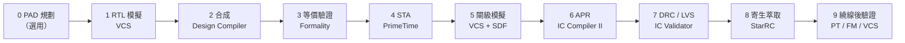

# IC_flow_skill

**把一份 Verilog 程式一路做成晶片版圖（RTL → GDS），每一步都有腳本、有說明、有判定。**

對象是第一次接觸數位 IC 後段流程的學生，例如做完 IC Contest 題目、想知道「合成之後還要做什麼」的人。

它是一個標準格式的 **skill**（一個資料夾，裡面有 `SKILL.md` 說明檔和腳本），**OpenAI Codex、Claude Code 等支援 skill 的 AI 程式助手都能用**；裝進去之後，你用中文問 IC 流程的問題，AI 助手就會照這份教材回答、幫你建專案和跑腳本。

裝好之後你會得到兩樣東西：

| | 是什麼 | 你可以拿它做什麼 |
|---|---|---|
| **`digital-ic-flow` skill** | 給 AI 助手看的「教材＋腳本範本」 | 問 AI 助手「下一步要做什麼？」「這個 DRC 錯誤是什麼意思？」「幫我寫 PrimeTime 腳本」，它會照這份教材回答，並用裡面的公版腳本幫你建專案、跑流程 |
| **`/ic_flow` 面板**（選用） | 即時進度面板（目前只有 Claude Code 能用） | 看專案跑到哪一步、哪一步 PASS／FAIL、關鍵數字；點任一階段看白話說明 |

> 腳本整理自實際做過的 lab（IC Contest 的 geofence、REFRACT），在 SAED32 教學製程與 CBDK_IC_Contest 上跑過，[完整流程的結果](#五分鐘體驗不用裝-eda-工具)放在 `examples/`。

---

## 目錄

1. [先搞懂：這個流程在做什麼？](#先搞懂這個流程在做什麼)
2. [五分鐘體驗（不用裝 EDA 工具）](#五分鐘體驗不用裝-eda-工具)
3. [安裝](#安裝)
4. [用它跑你自己的設計](#用它跑你自己的設計)
5. [看懂結果](#看懂結果)
6. [卡關了怎麼辦](#卡關了怎麼辦)
7. [常見問題](#常見問題)
8. [需求、限制、檔案說明](#需求與限制)

---

## 先搞懂：這個流程在做什麼？

你寫的 Verilog（**RTL**）只是「描述電路行為的程式」。要變成真的晶片，還要經過一連串工具把它變成**邏輯閘**，再把邏輯閘**擺到矽晶片上、用金屬線連起來**，最後檢查做出來的東西**又快又正確、而且工廠做得出來**。

可以把它想成蓋房子：

| 蓋房子 | 晶片流程 | 這個 repo 的階段 |
|---|---|---|
| 寫需求、確認格局合理 | 寫 RTL、跑模擬確認功能對 | 1 RTL 模擬 |
| 把需求換成標準建材清單 | **合成**：RTL → 標準元件（AND、OR、正反器…）組成的 netlist | 2 合成 |
| 確認建材清單跟需求一致 | **等價驗證**：數學證明 netlist 和 RTL 功能一樣 | 3 Formality |
| 估算水電夠不夠用 | **STA**：算每條訊號路徑在時脈內跑不跑得完 | 4 STA |
| 用建材清單再模擬一次 | **閘級模擬**：netlist 加上元件延遲再跑一次 testbench | 5 閘級模擬 |
| 畫平面圖、擺家具、拉管線 | **APR**：擺放元件、長時脈樹、繞線 | 6 APR |
| 建管處審圖 | **DRC／LVS**：檢查版圖合不合製程規則、和電路圖一不一致 | 7 DRC／LVS |
| 量實際管線長度 | **寄生萃取**：算出每條金屬線真正的電阻電容 | 8 StarRC |
| 用實際管線重新驗收 | 用真實線延遲再做一次 STA、等價驗證、模擬 | 9 繞線後驗證 |



**每一步怎樣才算過？** 不是看工具有沒有當掉，而是**讀報告**：例如 STA 的 slack（時間餘裕）要 ≥ 0、DRC 要 `CLEAN`、LVS 要 `PASS`。每個腳本最後都會自己讀報告、印出 `XXX_PASS` 或失敗，你不用自己翻幾千行 log。

### 要不要加 PAD？

**PAD** 是晶片邊緣的接腳零件，負責打線、防靜電、推動板子上的負載。比賽通常只做「核心」（沒有 PAD）；真正的晶片則一定要有。

| | 無 PAD（`USE_PAD 0`） | 有 PAD（`USE_PAD 1`） |
|---|---|---|
| 做到哪 | 只有你的電路本體 | 你的電路＋外圍一圈 PAD 的完整晶片 |
| 時序 | 不考慮 PAD | 輸入多約 0.4 ns、輸出推 1 pF 約 1.3 ns，**從 RTL 模擬就看得到** |
| 晶片大小 | 小（例：240 µm） | 被 PAD 數量撐大（例：920 µm） |
| DRC／LVS | 可以完全通過 | 最多到 `PAD_LIMITED`（見[限制](#需求與限制)） |
| 適合 | 先把流程跑通 | 想看完整晶片長什麼樣子 |

不確定的話，**兩種都跑來比較**。AI 助手每次開始跑流程前都會問你選哪一種。

---

## 五分鐘體驗（不用裝 EDA 工具）

`examples/` 裡放了兩個**已經跑完**的 geofence 專案，一個無 PAD、一個有 PAD。只要有 Python 3 就能看結果：

```bash
git clone https://github.com/charlesHYC/IC_flow_skill.git
cd IC_flow_skill
python3 skills/digital-ic-flow/templates/00_common/flow_dashboard.py examples/geofence_core
python3 skills/digital-ic-flow/templates/00_common/flow_dashboard.py examples/geofence_pad
```

你會看到像這樣的表格（有 PAD 版本，節錄）：

```
┌──────────────────────────────────────────────┬─────────────┬──────────────────────────────────────────┬──────────┐
│ Stage (steps)                                │ Status      │ Key numbers                              │ Time     │
├──────────────────────────────────────────────┼─────────────┼──────────────────────────────────────────┼──────────┤
│ PAD_planning (pad_wrapper, pad_delay_model)  │ PASS        │ pads 24, in 0.42/0.34, out 1.23/1.36 ns  │ 0:00     │
│ RTL_coding (vcs_simulation)                  │ PASS        │                                          │ 0:02     │
│ Synthesis (design_compiler_synthesis)        │ PASS        │ area 6013.8, setup +8.589 ns             │ 0:13     │
│ ...                                          │             │                                          │          │
│ DRC (icv_drc)                                │ PAD_LIMITED │ core 0, io_ring 2120, stitch 4           │ 3:37 x3  │
│ LVS (icv_lvs_transistor)                     │ PAD_LIMITED │ MOS 25,640, RES 8 matched                │ 0:23 x2  │
│ STA_postroute (primetime_spef)               │ PASS        │ setup +22.877 / hold +0.016 ns           │ 0:19 x2  │
│ Gate_post (vcs_postroute_sdf)                │ PASS        │ SDF $removal warn 17/17                  │ 0:07     │
└──────────────────────────────────────────────┴─────────────┴──────────────────────────────────────────┴──────────┘
  ALL_STAGES_DONE_PAD_LIMITED  全部跑完；DRC／LVS 只剩 IO library 的問題，這不等於 PASS。
```

完整表格：[geofence_core](examples/geofence_core/flow_table.txt)（全部 PASS）、[geofence_pad](examples/geofence_pad/flow_table.txt)。表格每一欄的意思見[看懂結果](#看懂結果)。

用 Claude Code 並裝了面板的話，輸入 `/ic_flow <你 clone 的路徑>/examples/geofence_pad`，就能在面板上點每個階段看說明和動畫。

---

## 安裝

skill 本身就是 `skills/digital-ic-flow/` 這個資料夾，把它複製到你的 AI 助手讀 skill 的地方就好。

### OpenAI Codex

```bash
git clone https://github.com/charlesHYC/IC_flow_skill.git
mkdir -p ~/.codex/skills
cp -r IC_flow_skill/skills/digital-ic-flow ~/.codex/skills/
```

重新啟動 `codex` 就會生效。之後直接用中文問 IC 流程的問題即可；想明確指定時，可以在訊息裡打 `$digital-ic-flow`。

### Claude Code

只要 skill：

```bash
git clone https://github.com/charlesHYC/IC_flow_skill.git
mkdir -p ~/.claude/skills
cp -r IC_flow_skill/skills/digital-ic-flow ~/.claude/skills/
```

想要 skill＋`/ic_flow` 面板一起裝，在 Claude Code 的提示列輸入：

```
/plugin install ic-flow --marketplace charlesHYC/IC_flow_skill
```

出現 `Add marketplace?` 時按 `y`，選安裝範圍時直接按 Enter，看到 `Installed ic-flow` 就完成了。

### 其他 AI 助手

支援 `SKILL.md` 格式的工具，照它的說明把 `skills/digital-ic-flow/` 放到 skill 資料夾即可。不支援的話，也可以把 `SKILL.md` 的內容貼給它當作說明，腳本在 `templates/` 裡照樣能用。

---

## 用它跑你自己的設計

### 第 1 步：準備好這些檔案

| 你需要 | 例子（geofence） | 說明 |
|---|---|---|
| RTL | `rtl/geofence.v` | 你的設計 |
| testbench | `tb/tb.sv` | 比賽給的 tb 就可以 |
| 測資 | `patterns/` | tb 會讀的輸入／標準答案 |
| tb 成功時印的字 | `ALL PASS` | 腳本用它判斷模擬有沒有過 |
| 時脈 | port 名稱 `clk`、週期 30 ns | 比賽題目通常有規定 |

建議的專案資料夾長這樣（`scripts/` 和 `runs/` 會自動產生）：

```
my_project/
├── rtl/        你的 Verilog
├── tb/         testbench
├── patterns/   測資
├── scripts/    公版腳本（AI 助手幫你複製進來）
└── runs/       每個階段的輸出，一個階段一個資料夾
```

### 第 2 步：建專案、改設定（手動）

**(1) 把公版腳本複製到 `scripts/`**（所有階段的腳本放在同一層）：

```bash
cd my_project
mkdir -p scripts
cp <IC_flow_skill 的路徑>/skills/digital-ic-flow/templates/*/* scripts/
```

**(2) 改這幾個檔案**。每個腳本開頭都有標「依設計修改」的區塊，只要改那裡：

| 檔案 | 要改什麼 |
|---|---|
| `scripts/flow_config.tcl` | **總設定**，最重要（見下面） |
| `scripts/run_rtl_sim.sh`、`scripts/run_gate_sim.sh` | tb 路徑 `TB`、tb 的 top `TOP`、測資 `PATTERNS`、成功字串 `PASS_MARKER`、`DESIGN` |
| `scripts/constraints_saed32.sdc`（SAED32）或 `constraints.sdc`（CBDK） | 輸入／輸出延遲、輸出負載；比賽有規定就照規定 |
| `scripts/run_icv_drc.sh`、`run_icv_lvs.sh`、`run_starrc.sh` | `DESIGN`、製程檔路徑 |

`flow_config.tcl` 最重要的幾行：

```tcl
set DESIGN     geofence                       ;# 你的 top module 名稱
set RTL_FILES  [list $PROJ/rtl/geofence.v]    ;# RTL 檔案
set CLK_PORT   clk                            ;# 時脈 port
set PERIOD     30.0                           ;# 時脈週期（ns）
set USE_PAD    0                              ;# 0 = 無 PAD，1 = 有 PAD
set PROCESS    saed32                         ;# saed32 或 cbdk
```

再往下還有製程檔路徑（`/mnt/nfs/opt/PROCESS/...`），請改成你機器上的位置。

**(3) 載入 EDA 工具環境**：各學校／公司的方式不同，例如 `source /usr/cad/synopsys/CIC/...` 或 `module load ...`。確認 `vcs`、`dc_shell`、`fm_shell`、`pt_shell`、`icc2_shell`、`icv` 打得出來。`scripts/run_stage.sh` 第 8 行預設是 `source /.bash_EDA`，請改成你的方式。

> 不想手動改的話，也可以請 AI 助手代勞：在 `my_project/` 裡啟動 `codex` 或 `claude`，說「用 digital-ic-flow 幫我把這個設計建成完整流程，設計叫 geofence，clock 是 clk、30 ns」。它會先問要不要上 PAD，再幫你複製、填好上面這些檔案。

### 第 3 步：跑起來

有兩種跑法，結果完全一樣：

- **方法 A：用包裝好的腳本**（建議）。`run_stage.sh` 會幫你切到正確的資料夾、存 log、自動讀報告判定 PASS／FAIL、更新流程表格。
- **方法 B：自己下工具指令**。想知道每一步實際跑了什麼，或要在別的環境手動跑時用。

#### 方法 A：`run_stage.sh`

```bash
bash scripts/run_stage.sh pad          # 0  只有 USE_PAD 1 才會做事
bash scripts/run_stage.sh rtl_sim      # 1  RTL 模擬
bash scripts/run_stage.sh synthesis    # 2  合成
bash scripts/run_stage.sh formality    # 3  等價驗證
bash scripts/run_stage.sh sta          # 4  STA（三個 corner）
bash scripts/run_stage.sh gate_sim     # 5  閘級模擬
bash scripts/run_stage.sh ndm          # 6-0 建 APR 用的 library
bash scripts/run_stage.sh apr          # 6  floorplan → place → CTS → route
bash scripts/run_stage.sh eco          # 6  修剩下的 max_cap／transition
bash scripts/run_stage.sh finish       # 6  補 filler、寫出 GDS 與 netlist
bash scripts/run_stage.sh drc          # 7a DRC
bash scripts/run_stage.sh lvs          # 7b LVS
bash scripts/run_stage.sh starrc       # 8  寄生萃取
bash scripts/run_stage.sh pt_post      # 9a 繞線後 STA
bash scripts/run_stage.sh fm_post      # 9b 繞線後等價驗證
bash scripts/run_stage.sh gate_post    # 9c 繞線後閘級模擬
```

一次全部跑完（geofence 約 20–30 分鐘），遇到失敗會停，修正回圈會自己跑：

```bash
bash scripts/run_all.sh
```

#### 方法 B：每一步的實際指令

規則都一樣：**先建好並進到 `runs/<階段>/` 資料夾**（`mkdir -p runs/<階段>/reports`，報告會寫在 `reports/`），執行工具，把畫面輸出存成 log，最後**在 log 裡找成功標記**，找到才算過。下面的指令都從專案根目錄 `my_project/` 開始。

| # | 階段 | 在哪個資料夾執行 | 指令 | log 裡要出現（行首） |
|---|---|---|---|---|
| 0 | PAD 規劃（只有 `USE_PAD 1`） | `runs/pad` | 見下方說明 | `PAD_PASS` |
| 1 | RTL 模擬 | `runs/rtl_sim` | `bash ../../scripts/run_rtl_sim.sh` | `ALL PASS` |
| 2 | 合成 | `runs/synthesis` | `dc_shell -f ../../scripts/dc_syn.tcl` | `DC_PASS` |
| 3 | 等價驗證 | `runs/formality` | `fm_shell -f ../../scripts/fm_rtl2gate.tcl` | `FM_PASS` |
| 4 | STA（三個 corner 各跑一次） | `runs/sta` | `FLOW_CORNER=slow pt_shell -f ../../scripts/pt_prelayout.tcl`，再把 `slow` 換成 `typical`、`fast` | `STA_PASS slow` 等 |
| 5 | 閘級模擬 | `runs/gate_sim` | `bash ../../scripts/run_gate_sim.sh` | `GATE_SIM_PASS` |
| 6-0 | 建 NDM library | `runs/ndm` | `icc2_lm_shell -f ../../scripts/build_ndm.tcl` | `NDM_PASS` |
| 6 | APR | `runs/apr` | `icc2_shell -f ../../scripts/apr_core.tcl` | `APR_ROUTED` |
| 6 | APR ECO | `runs/apr` | `icc2_shell -f ../../scripts/apr_eco.tcl` | `APR_PASS` |
| 6 | Finish | `runs/finish` | `icc2_shell -f ../../scripts/apr_finish.tcl` | `FINISH_PASS` |
| 7a | DRC | `runs/drc` | `bash ../../scripts/run_icv_drc.sh` | `DRC_PASS`（PAD 模式 `DRC_PAD_LIMITED`） |
| 7b | LVS | `runs/lvs` | `bash ../../scripts/run_icv_lvs.sh` | `LVS_PASS`（PAD 模式 `LVS_PAD_LIMITED`） |
| 8 | 寄生萃取 | `runs/starrc` | `bash ../../scripts/run_starrc.sh` | `STARRC_PASS` |
| 9a | 繞線後 STA（三個 corner） | `runs/pt_post` | `FLOW_CORNER=slow pt_shell -f ../../scripts/pt_postroute.tcl`，再換 `typical`、`fast` | `POSTROUTE_STA_PASS slow` 等 |
| 9b | 繞線後等價驗證 | `runs/fm_post` | `fm_shell -f ../../scripts/fm_postroute.tcl` | `FM_POST_PASS` |
| 9c | 繞線後閘級模擬 | `runs/gate_post` | `POSTROUTE=1 bash ../../scripts/run_gate_sim.sh` | `GATE_SIM_PASS` |

例如手動跑合成：

```bash
mkdir -p runs/synthesis/reports
cd runs/synthesis
dc_shell -f ../../scripts/dc_syn.tcl < /dev/null | tee console.log
grep '^DC_PASS' console.log && echo "合成通過" || echo "合成失敗，看 console.log"
cd ../..
```

幾個要注意的地方：

- **`< /dev/null`**：tcl 中途出錯時，工具會停在提示字元等你輸入；接 `/dev/null` 會讓它直接結束，不會卡住。
- **有 PAD 時**：所有工具都會讀 `flow_config.tcl` 的 `USE_PAD`，也可以臨時用環境變數覆蓋，例如 `USE_PAD=1 dc_shell -f ...`。
- **第 0 步 PAD 規劃**的參數來自 `flow_config.tcl`（`IN_PAD`、`OUT_PAD`、IO library 路徑），手動跑時是兩行 Python：
  ```bash
  python3 scripts/pad_tools.py wrapper  <DESIGN> runs/pad <IN_PAD> <OUT_PAD> rtl/*.v
  python3 scripts/pad_tools.py padmodel <IO 的 .lib> <IN_PAD> <OUT_PAD> runs/pad/io_pad_sim.v 0.10 5 0.10 1000
  ```
  第一行從 RTL 的 port 產生晶片外殼 `<DESIGN>_chip.v`，第二行從 IO library 查表算出 PAD 延遲。
- **修正回圈**（只有出問題才要跑）：
  - DRC 有 M1 細條錯誤：在 `runs/apr` 跑 `icc2_shell -f ../../scripts/apr_drc_patch.tcl`（成功標記 `DRC_PATCH_PASS`），再重跑 Finish → DRC。
  - 繞線後 STA 有違規：在 `runs/apr` 跑 `icc2_shell -f ../../scripts/apr_signoff_eco.tcl`（`SIGNOFF_ECO_PASS`），再重跑 Finish → DRC → LVS → StarRC → 繞線後 STA。
- 有些機器的 ICV／Formality 會和系統的 Kerberos 函式庫衝突而無法啟動，`run_stage.sh` 裡的 `krb_fix` 是當時的解法，你的環境不一定需要。

### 第 4 步：看進度

- **終端機**：`bash scripts/run_stage.sh status`，隨時印出流程表格。
- **`/ic_flow` 面板**（Claude Code 裝了 plugin 才有）：輸入 `/ic_flow`，右邊會開即時面板，每 5 秒更新：
  - 正在跑的階段有轉圈動畫 `⠋ RUNNING`。
  - **點任一階段**，下面會顯示這一步在做什麼（What）、怎樣算過（Pass）、產出什麼（Output）、關鍵數字（Numbers）、log 裡的結果行（Results）和 log 位置。
  - 下方 **History** 列出跑過的專案，點一下或按 1–5 切換。
  - 按 `Esc` 關閉。

---

## 看懂結果

### 表格的每一欄

| 欄位 | 意思 |
|---|---|
| **Stage (steps)** | 階段名稱，括號裡是這一步做的事。名字後面有 `*` 的是**修正回圈**：只有上一步發現問題才會跑 |
| **Status** | 這一步的判定（見下表） |
| **Key numbers** | 最重要的數字，例如合成的面積和 slack、DRC 錯誤數 |
| **Time** | 花了多久；`x3` 表示這一輪跑了 3 次（修正回圈會讓同一步重跑） |

### 狀態

| 狀態 | 意思 | 要做什麼 |
|---|---|---|
| `PASS` | 報告確認通過 | 繼續下一步 |
| `FAIL` | 報告裡有問題 | 看 log，見[卡關了怎麼辦](#卡關了怎麼辦) |
| `RUNNING` | 正在跑 | 等 |
| `PAD_LIMITED` | 只有 PAD 模式會出現：你的電路沒問題，錯誤都在 PAD library 裡 | **這不是 PASS**，但已經是這套教學製程能做到的最好結果 |
| `-` | 還沒跑 | |
| `skip` | 無 PAD 模式跳過 PAD 規劃 | |
| `not needed` | 修正回圈不需要跑 | |

### 幾個常看到的數字

| 數字 | 意思 | 好的範圍 |
|---|---|---|
| **setup slack** | 訊號在下一個時脈來之前，還多出多少時間 | ≥ 0（負的代表太慢，要放寬週期或改電路） |
| **hold slack** | 訊號會不會太快、蓋掉上一筆資料 | ≥ 0 |
| **area** | 元件總面積（µm²） | 越小越好（比賽常用面積 × 時間評分） |
| **DRC core 0** | 你的電路區域沒有違反製程規則 | 0 |
| **MOS matched** | LVS 對上的電晶體數 | 全部對上 |

三個 **corner**（slow／typical／fast）是指晶片在「最慢、一般、最快」三種製程、電壓、溫度條件下都要能正常運作。

---

## 卡關了怎麼辦

1. **看是哪一步 FAIL**：`bash scripts/run_stage.sh status`，或在 `/ic_flow` 點那一列看 Results。
2. **看 log**：每一步的輸出都在 `runs/<階段>/console.log`。
3. **直接問 AI 助手**：
   > synthesis FAIL 了，幫我看 runs/synthesis/console.log 是什麼問題。

   這個 skill 裡有一份「實際踩過的坑」清單（[`pitfalls.md`](skills/digital-ic-flow/references/pitfalls.md)），AI 助手會先對照它。
4. **修好後重跑那一步**，例如 `bash scripts/run_stage.sh synthesis`，再繼續往下。

---

## 常見問題

**Q：我沒有 Synopsys 工具，可以用嗎？**
可以看 demo、讀教材、問 AI 助手流程的問題；但要真的跑流程，需要學校或公司的 Synopsys 授權與伺服器。

**Q：可以用在比賽嗎？**
IC Contest 通常只評到第 5 步（RTL 模擬＋合成後閘級模擬），第 6–9 步是延伸練習。比賽用 CBDK_IC_Contest 製程時，把 `PROCESS` 設成 `cbdk`。

**Q：`PAD_LIMITED` 是我做錯了嗎？**
不是。SAED32 教學製程的 PAD library 自己的版圖檔和規格檔彼此不一致，加 PAD 的晶片一定會有這些錯誤。腳本會幫你確認錯誤都在 PAD 裡、你的電路是乾淨的。要完全乾淨的 DRC／LVS，用無 PAD 模式。

**Q：看不懂縮寫（STA、CTS、SDF…）？**
看 [`glossary.md`](skills/digital-ic-flow/references/glossary.md)，每個縮寫都有全名和白話解釋；或直接問 AI 助手「SDF 是什麼？」。

**Q：每一步的原理在哪裡？**
[`flow_stages.md`](skills/digital-ic-flow/references/flow_stages.md)：每個階段的目的、做法、檢查清單。

---

## 需求與限制

**需求**
- 支援 skill 的 AI 程式助手：OpenAI Codex、Claude Code 等
- Python 3
- 真的要跑流程時：Synopsys VCS、Design Compiler、Formality、PrimeTime、IC Compiler II、IC Validator、StarRC（要自己有授權）
- 製程：SAED32 EDK 或 CBDK_IC_Contest

**要依你的環境修改**
- 工具環境：`run_stage.sh` 預設執行 `source /.bash_EDA` 載入工具，請改成你機器上的設定方式。
- 製程路徑：腳本裡的 `/mnt/nfs/opt/PROCESS/...` 是範例路徑，請改成你機器上製程檔的位置。**製程檔不包含在這個 repo 裡**（SAED32 依授權不得另行散布）。

**已知限制**
- 有 PAD 模式只支援 SAED32（CBDK_IC_Contest 沒有 PAD library）。
- 有 PAD 模式的 DRC／LVS 最多到 `PAD_LIMITED`（原因見[常見問題](#常見問題)與 [`pitfalls.md`](skills/digital-ic-flow/references/pitfalls.md)）。
- 還沒實測過：`PROCESS cbdk` 用本公版跑完全流程、雙向（inout）PAD、`io_std` 以外的 PAD library。

### 檔案說明

```
IC_flow_skill/
├── skills/digital-ic-flow/          ← skill 本體
│   ├── SKILL.md                     給 AI 助手看的總說明與規則
│   ├── references/
│   │   ├── flow_stages.md           每個階段的原理與檢查清單
│   │   ├── pitfalls.md              實際踩過的錯誤與解法
│   │   └── glossary.md              縮寫對照（全名＋白話）
│   └── templates/                   公版腳本，會被複製到你專案的 scripts/
│       ├── 00_common/               總設定 flow_config.tcl、run_stage.sh、run_all.sh、流程表格
│       ├── 01_rtl_sim/ … 07_signoff/  各階段腳本
├── examples/                        兩個跑完的 demo（無 PAD／有 PAD）
├── hooks/  types/                   /ic_flow 面板的程式（Claude Code plugin，選用）
└── .claude-plugin/                  Claude Code plugin 安裝設定（選用）
```

## 授權

[MIT](LICENSE)：可以自由使用、修改、分享，保留版權聲明即可。
