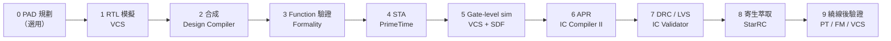

# IC_flow_skill

**把一份 Verilog 程式一路做成晶片版圖（RTL → GDS），每一步都有腳本、有說明、有判定。**

對象是第一次接觸數位 IC 後段流程的學生，例如做完 IC Contest 題目、想知道「合成之後還要做什麼」的人。

它是一個標準格式的 **skill**（一個資料夾，裡面有 `SKILL.md` 說明檔和腳本），**OpenAI Codex、Claude Code 等支援 skill 的 AI 程式助手都能用**；裝進去之後，你用中文問 IC 流程的問題，AI 助手就會照這份教材回答、幫你建專案和跑腳本。

裝好之後你會得到兩樣東西：

| | 是什麼 | 你可以拿它做什麼 |
|---|---|---|
| **`digital-ic-flow` skill** | 給 AI 助手看的「教材＋腳本範本」 | 問 AI 助手「下一步要做什麼？」「這個 DRC 錯誤是什麼意思？」「幫我寫 PrimeTime 腳本」，它會照這份教材回答，並用裡面的公版腳本幫你建專案、跑流程 |
| **`/ic_flow` 面板**（選用） | 即時進度面板（目前只有 Claude Code 能用） | 看專案跑到哪一步、哪一步 PASS／FAIL、關鍵數字；點任一階段看白話說明 |

> 這是給任何 cell-based 數位 IC 設計用的教學公版：把腳本複製到自己的專案，照自己的設計一個階段一個階段修改。公版用 IC Contest 題目當例子在 SAED32 教學製程上從頭跑過，無 PAD 與有 PAD 兩種都是 `ALL_STAGES_PASS`（DRC CLEAN、LVS PASS），[完整結果](#五分鐘體驗不用裝-eda-工具)放在 `examples/`，數字見[驗證狀態](#驗證狀態)。
>
> 想要不自動化、每一步自己改自己跑的版本，見姊妹 repo [ic-flow-template](https://github.com/charlesHYC/ic-flow-template)：同樣的流程，只給每個階段的公版腳本，判斷交給你自己。

---

## 目錄

1. [先搞懂：這個流程在做什麼？](#先搞懂這個流程在做什麼)
2. [五分鐘體驗（不用裝 EDA 工具）](#五分鐘體驗不用裝-eda-工具)
3. [安裝](#安裝)
4. [用它跑你自己的設計](#用它跑你自己的設計)
5. [每個階段用哪些腳本](#每個階段用哪些腳本)
6. [看懂結果](#看懂結果)
7. [卡關了怎麼辦](#卡關了怎麼辦)
8. [常見問題](#常見問題)
9. [驗證狀態](#驗證狀態)
10. [需求、限制、檔案說明](#需求與限制)

---

## 先搞懂：這個流程在做什麼？

你寫的 Verilog（**RTL**）只是「描述電路行為的程式」。要變成真的晶片，還要經過一連串工具把它變成**邏輯閘**，再把邏輯閘**擺到矽晶片上、用金屬線連起來**，最後檢查做出來的東西**又快又正確、而且工廠做得出來**。

可以把它想成蓋房子：

| 蓋房子 | 晶片流程 | 這個 repo 的階段 |
|---|---|---|
| 寫需求、確認格局合理 | 寫 RTL、跑模擬確認功能對 | 1 RTL 模擬 |
| 把需求換成標準建材清單 | **合成**：RTL → 標準元件（AND、OR、正反器…）組成的 netlist | 2 合成 |
| 確認建材清單跟需求一致 | **Function 驗證**：數學證明 netlist 和 RTL 功能一樣 | 3 Formality |
| 估算水電夠不夠用 | **STA**：算每條訊號路徑在時脈內跑不跑得完 | 4 STA |
| 用建材清單再模擬一次 | **Gate-level sim**：netlist 加上元件延遲再跑一次 testbench | 5 Gate-level sim |
| 畫平面圖、擺家具、拉管線 | **APR**：擺放元件、長時脈樹、繞線 | 6 APR |
| 建管處審圖 | **DRC／LVS**：檢查版圖合不合製程規則、和電路圖一不一致 | 7 DRC／LVS |
| 量實際管線長度 | **寄生萃取**：算出每條金屬線真正的電阻電容 | 8 StarRC |
| 用實際管線重新驗收 | 用真實線延遲再做一次 STA、Function 驗證、模擬 | 9 繞線後驗證 |



**每一步怎樣才算過？** 不是看工具有沒有當掉，而是**讀報告**：例如 STA 的 slack（時間餘裕）要 ≥ 0、DRC 要 `CLEAN`、LVS 要 `PASS`。每個腳本最後都會自己讀報告、印出 `XXX_PASS` 或失敗，你不用自己翻幾千行 log。

### 要不要加 PAD？

**PAD** 是晶片邊緣的接腳零件，負責打線、防靜電、推動板子上的負載。比賽通常只做「核心」（沒有 PAD）；真正的晶片則一定要有。

| | 無 PAD（`USE_PAD 0`） | 有 PAD（`USE_PAD 1`） |
|---|---|---|
| 做到哪 | 只有你的電路本體 | 你的電路＋外圍一圈 PAD 的完整晶片 |
| 時序 | 不考慮 PAD | 輸入多約 0.4 ns、輸出推 1 pF 約 1.3 ns，**從 RTL 模擬就看得到** |
| 晶片大小 | 依合成面積決定 | 被 PAD 數量撐大（例：49 個 PAD → 1200 µm） |
| DRC／LVS | 可以完全通過 | 可以完全通過（IO library 先經 `fix_io_lib.py` 修正，見[限制](#需求與限制)） |
| 適合 | 先把流程跑通 | 想看完整晶片長什麼樣子 |

不確定的話，**兩種都跑來比較**。AI 助手每次開始跑流程前都會問你選哪一種。

PAD 是什麼、SAED32 提供哪些 PAD 資料、怎麼選 PAD、每一步要多做什麼、怎麼確認用對、corner pad 是什麼，見 [`flow_stages.md` 第 11 節](skills/digital-ic-flow/references/flow_stages.md#11-io-pad-完整說明)。

---

## 五分鐘體驗（不用裝 EDA 工具）

`examples/` 裡放了一個例子設計（2026 IC Contest 的 REFRACT 題目）**已經跑完**的結果，一份無 PAD、一份有 PAD，兩份都是 `ALL_STAGES_PASS`。只要有 Python 3 就能看結果：

```bash
git clone https://github.com/charlesHYC/IC_flow_skill.git
cd IC_flow_skill
python3 skills/digital-ic-flow/templates/00_common/flow_dashboard.py examples/refract_core
python3 skills/digital-ic-flow/templates/00_common/flow_dashboard.py examples/refract_pad
```

你會看到像這樣的表格（有 PAD 版本，節錄）：

```
┌──────────────────────────────────────────────┬─────────────┬──────────────────────────────────────────┬──────────┐
│ Stage (steps)                                │ Status      │ Key numbers                              │ Time     │
├──────────────────────────────────────────────┼─────────────┼──────────────────────────────────────────┼──────────┤
│ PAD_planning (pad_wrapper, pad_delay_model)  │ PASS        │ pads 49, in 0.42/0.34, out 1.23/1.36 ns  │ 0:08     │
│ Synthesis (design_compiler_synthesis)        │ PASS        │ area 23532.2, setup +0.205 ns            │ 0:30     │
│ DRC (icv_drc)                                │ PASS        │ CLEAN                                    │ 6:54 x4  │
│ ...                                          │             │                                          │          │
│ LVS (icv_lvs_transistor)                     │ PASS        │ PASS                                     │ 0:41 x3  │
│ STA_postroute (primetime_spef)               │ PASS        │ setup +37.179 / hold +0.000 ns           │ 0:20 x3  │
│ Gate_post (vcs_postroute_sdf)                │ PASS        │ SDF $removal warn 619/619                │ 1:26     │
└──────────────────────────────────────────────┴─────────────┴──────────────────────────────────────────┴──────────┘
  ALL_STAGES_PASS  全部階段通過。
```

完整表格：[refract_core](examples/refract_core/flow_table.txt)、[refract_pad](examples/refract_pad/flow_table.txt)。表格每一欄的意思見[看懂結果](#看懂結果)。

用 Claude Code 並裝了面板的話，輸入 `/ic_flow <你 clone 的路徑>/examples/refract_pad`，就能在面板上點每個階段看說明和動畫。

---

## 安裝

skill 本身就是 `skills/digital-ic-flow/` 這個資料夾，把它複製到你的 AI 助手讀 skill 的地方就好。

### OpenAI Codex

```bash
git clone https://github.com/charlesHYC/IC_flow_skill.git
mkdir -p ~/.codex/skills
cp -r IC_flow_skill/skills/digital-ic-flow ~/.codex/skills/
```

重新啟動 `codex` 就會生效。之後直接用中文問 IC 流程的問題即可；想明確指定時，可以在訊息裡打 `$digital-ic-flow`。

### Claude Code

只要 skill：

```bash
git clone https://github.com/charlesHYC/IC_flow_skill.git
mkdir -p ~/.claude/skills
cp -r IC_flow_skill/skills/digital-ic-flow ~/.claude/skills/
```

想要 skill＋`/ic_flow` 面板一起裝，在 Claude Code 的提示列輸入：

```
/plugin install ic-flow --marketplace charlesHYC/IC_flow_skill
```

出現 `Add marketplace?` 時按 `y`，選安裝範圍時直接按 Enter，看到 `Installed ic-flow` 就完成了。

### 其他 AI 助手

支援 `SKILL.md` 格式的工具，照它的說明把 `skills/digital-ic-flow/` 放到 skill 資料夾即可。不支援的話，也可以把 `SKILL.md` 的內容貼給它當作說明，腳本在 `templates/` 裡照樣能用。

---

## 用它跑你自己的設計

### 第 1 步：準備好這些檔案

| 你需要 | 例子 | 說明 |
|---|---|---|
| RTL | `rtl/MY_TOP.v` | 你的設計 |
| testbench | `tb/tb.v` | 比賽給的 tb 就可以 |
| 測資 | `patterns/` | tb 會讀的輸入／標準答案 |
| tb 成功時印的字 | `ALL PASS` | 腳本用它判斷模擬有沒有過 |
| 時脈 | port 名稱 `clk`、週期 30 ns | 比賽題目通常有規定 |

建議的專案資料夾長這樣（`scripts/` 和 `runs/` 會自動產生）：

```
my_project/
├── rtl/        你的 Verilog
├── tb/         testbench
├── patterns/   測資
├── scripts/    公版腳本（AI 助手幫你複製進來）
└── runs/       每個階段的輸出，一個階段一個資料夾
```

### 第 2 步：建專案、改設定（手動）

**(1) 把公版腳本複製到 `scripts/`**（所有階段的腳本放在同一層）：

```bash
cd my_project
mkdir -p scripts
cp <IC_flow_skill 的路徑>/skills/digital-ic-flow/templates/*/* scripts/
```

**(2) 改這幾個檔案**。共用的設計資訊只寫在 `flow_config.tcl` 一個地方；各階段跟設計有關的值放在腳本開頭標「依設計修改」的區塊，每個值都有註解說明是什麼、什麼時候要改。標 `←` 的值一定要換成你自己的：

| 檔案 | 要改什麼 |
|---|---|
| `scripts/flow_config.tcl` | **總設定**，最重要（見下面）。top 名稱、RTL 清單、I/O delay 只寫在這裡，SDC、APR 和各 `.sh` 腳本都讀它 |
| `scripts/run_rtl_sim.sh`、`scripts/run_gate_sim.sh` | tb 路徑 `TB`、tb 的 top `TOP`、測資 `PATTERNS`、成功字串 `PASS_MARKER` |
| `scripts/constraints_saed32.sdc`（SAED32）或 `constraints.sdc`（CBDK） | 輸出負載、clock uncertainty；I/O delay 的數字在 `flow_config.tcl` |
| `scripts/dc_syn.tcl` | hold／removal 用哪個 corner 修（`DC_HOLD_CORNER`）、max_cap 收緊比例（`MAXCAP_DERATE`），檔頭有取捨說明 |
| `scripts/apr_core.tcl` | die 大小 `DIE`（看合成面積決定）、I/O 餘裕、繞線修正參數 |
| `scripts/run_icv_drc.sh`、`run_icv_lvs.sh`、`run_starrc.sh` | 製程檔路徑 |

`flow_config.tcl` 最重要的幾行：

```tcl
set DESIGN     MY_TOP                         ;# 你的 top module 名稱（沒改的話 run_stage.sh 會提示）
set RTL_FILES  [list $PROJ/rtl/$DESIGN.v]     ;# RTL 檔案，多個就列多個
set CLK_PORT   clk                            ;# 時脈 port
set PERIOD     30.0                           ;# 時脈週期（ns）
set IN_DELAY_MAX 1.0 ; set IN_DELAY_MIN 0.0   ;# 輸入延遲（照題目的 SDC）
set OUT_DELAY_MAX 1.0; set OUT_DELAY_MIN 0.0  ;# 輸出延遲
set USE_PAD    0                              ;# 0 = 無 PAD，1 = 有 PAD
set PROCESS    saed32                         ;# saed32 或 cbdk
```

再往下還有製程檔路徑（`/mnt/nfs/opt/PROCESS/...`），請改成你機器上的位置。

**(3) 載入 EDA 工具環境**：各學校／公司的方式不同，例如 `source /usr/cad/synopsys/CIC/...` 或 `module load ...`。確認 `vcs`、`dc_shell`、`fm_shell`、`pt_shell`、`icc2_shell`、`icv` 打得出來。`scripts/run_stage.sh` 第 8 行預設是 `source /.bash_EDA`，請改成你的方式。

> 不想手動改的話，也可以請 AI 助手代勞：在 `my_project/` 裡啟動 `codex` 或 `claude`，說「用 digital-ic-flow 幫我把這個設計建成完整流程，top 叫 MY_TOP，clock 是 clk、30 ns」。它會先問要不要上 PAD，再幫你複製、填好上面這些檔案。

### 第 3 步：跑起來

每個階段一個指令，依序執行：

```bash
bash scripts/run_stage.sh synthesis    # 例：跑合成
```

`run_stage.sh` 會切到 `runs/<階段>/`、執行對應的工具和腳本、把輸出存成 `console.log`，最後在 log 裡找成功標記判定 PASS／FAIL。全部 16 個階段的名稱、各自用哪些 `.tcl`、想自己下工具指令怎麼下，見下一節[每個階段用哪些腳本](#每個階段用哪些腳本)。

也可以一次跑完（中小型設計約 20–30 分鐘），遇到失敗會停在那一階段。新設計第一次跑通常會在某些階段失敗，這時看報告、改那一階段的腳本或設定，再從那一階段重跑：

```bash
bash scripts/run_all.sh
```

### 第 4 步：看進度

- **終端機**：`bash scripts/run_stage.sh status`，隨時印出流程表格。
- **`/ic_flow` 面板**（Claude Code 裝了 plugin 才有）：輸入 `/ic_flow`，右邊會開即時面板，每 5 秒更新：
  - 正在跑的階段有轉圈動畫 `⠋ RUNNING`。
  - **點任一階段**，下面會顯示這一步在做什麼（What）、怎樣算過（Pass）、產出什麼（Output）、關鍵數字（Numbers）、log 裡的結果行（Results）和 log 位置。
  - 下方 **History** 列出跑過的專案，點一下或按 1–5 切換。
  - 按 `Esc` 關閉。

---

## 每個階段用哪些腳本

公版一共 29 個檔案，依流程階段分組如下。每一組寫出：用什麼工具、每個檔案在做什麼、產出什麼，以及怎麼執行。

**執行方式（每個階段都一樣）**

- 用包裝好的指令：`bash scripts/run_stage.sh <階段名>`（建議）。
- 自己下工具指令：
  ```bash
  mkdir -p runs/<階段名>/reports && cd runs/<階段名>
  <工具指令> < /dev/null | tee console.log    # < /dev/null：腳本出錯時工具不會卡在提示字元
  grep '^<成功標記>' console.log                # 找得到才算通過
  cd ../..
  ```

---

### 共用：設定與執行入口

> **為什麼要用腳本，不直接在工具裡打指令？**
> EDA 工具（DC、PT、ICC2…）都能用 Tcl 控制。把指令寫成 `.tcl`，同一個流程就可以重跑、改一個參數再跑、交給別人跑，結果都一樣；手打指令很難重現，也很難知道上次到底做了什麼。
>
> **為什麼要有總設定檔 `flow_config.tcl`？**
> 設計名稱、時脈、製程路徑在每個階段都會用到。集中在一個檔，換設計只要改一處，不會出現「合成用 30 ns、STA 卻用 20 ns」這種錯。
>
> **業界會這樣做嗎？** 會，而且規模大很多。公司通常有 CAD 團隊維護整套 flow：Synopsys 提供的 Reference Methodology（RM）腳本、內部的 Makefile 或 flow 管理工具，配上機房的工作排程系統（例如 LSF）。核心觀念相同：**設定集中、每步可重跑、讀報告自動判定**。

| 檔案 | 做什麼 |
|---|---|
| `flow_config.tcl` | **總設定**。設計名稱、RTL、時脈、週期、I/O delay、要不要上 PAD、製程與 library 路徑、三個 corner 的對照表。所有 `.tcl` 第一行都會讀它，SDC、APR、`.sh` 腳本也從這裡讀共用的值，換設計先改這一個檔 |
| `run_stage.sh` | 單一階段的入口：切到 `runs/<階段>/`、執行工具、存 log、找成功標記判定 PASS／FAIL；`run_stage.sh status` 印出流程表格 |
| `run_all.sh` | 依序跑完所有階段，包含修正回圈；遇到失敗會停 |
| `flow_dashboard.py` | 讀 `runs/` 裡的狀態檔，印出流程表格（也提供 `/ic_flow` 面板用的資料） |

---

### 0. PAD 規劃（只有 `USE_PAD 1`）— Python

決定晶片外圍要放哪些 PAD，並算出 PAD 的延遲，讓之後每一步都把 PAD 算進去。

> **為什麼要做？** 晶片要靠 PAD 才能和外界相連：PAD 負責打線、防靜電，還要推得動電路板上的負載（約 1 pF，比晶片內部大幾十倍）。所以 PAD 有明顯的延遲，會吃掉你的時序預算。這裡在設計一開始就把它加進來，從 RTL 模擬就看得到影響。
>
> **省略會怎樣？** 只做核心的話，時序看起來很寬鬆，但真正接上 PAD 後可能就不夠了。
>
> **業界會用嗎？** PAD 一定有，但做法不同：
> - PAD library 由晶圓廠或 IP 廠提供，IO ring 通常由負責整顆晶片的 top-level 團隊和封裝團隊一起規劃，不會用腳本自動排。
> - 業界的 RTL 模擬一般是零延遲，不會把 PAD 延遲放進去；IO 時序靠 STA 的 IO 約束和電路板時序分析來保證。這裡把 PAD 延遲放進 RTL 模擬是**教學設計**，讓你提早看到 PAD 的影響。

| 檔案 | 做什麼 |
|---|---|
| `pad_tools.py` | `wrapper`：讀 RTL 的 port，產生包住你設計的晶片外殼 `<DESIGN>_chip.v`（每個 port 接一顆 PAD）和 PAD 擺放計畫；`padmodel`：從 IO library 查表算出 PAD 延遲，寫成模擬用的 PAD model |
| `fix_io_lib.py` | 從製程原檔產生修正版 SAED32 IO library（GDS、CDL、LEF）和 DRC 規則檔副本，修掉 PAD 本身的錯誤；製程原檔不動，每一項修正的原因寫在檔頭 |
| `constraints_chip.sdc` | 晶片版的時序約束：port 在 PAD 外側、輸出推 1 pF 板級負載。之後合成、STA、APR 都用它取代核心版約束 |

產出：`runs/pad/<DESIGN>_chip.v`、`io_pad_sim.v`、`pad_plan.tcl`　　成功標記：`PAD_PASS`

```bash
bash scripts/run_stage.sh pad
```

---

### 1. RTL 模擬 — VCS

確認你寫的 RTL 功能正確，之後每一步都要和這個結果一致。

> **為什麼要做？** 這是唯一確認「設計本身對不對」的步驟。後面的合成、APR 都只負責「照你寫的做出來」，如果 RTL 本來就錯，後面做得再完美也是錯的晶片。
>
> **省略會怎樣？** 等到 Gate-level sim 或晶片做回來才發現功能錯，要從頭改、重跑整個流程。
>
> **業界會用嗎？** 會，而且是整個專案花最多人力的地方。差別是業界不會只用一個固定測資的 testbench：
> - 用 SystemVerilog／UVM 寫隨機測試，搭配**覆蓋率（coverage）**確認每個功能、每種狀況都測過。
> - 模擬前先做 **lint**（檢查寫法問題）和 **CDC**（跨時脈域檢查），本流程沒有包含。
> - 工具除了 VCS，也常見 Cadence Xcelium、Siemens Questa。

| 檔案 | 做什麼 |
|---|---|
| `run_rtl_sim.sh` | 用 VCS 編譯 tb＋RTL 並執行，檢查 tb 印出成功字串。有 PAD 時改模擬晶片外殼＋帶延遲的 PAD model；可用 `SIM_CASES` 讓同一個 tb 用不同 define 跑多次 |

成功標記：`ALL PASS`

```bash
cd runs/rtl_sim && bash ../../scripts/run_rtl_sim.sh
```

---

### 2. 邏輯合成 — Design Compiler

把 RTL 換成標準元件（AND、OR、正反器…）組成的 gate-level netlist。

> **為什麼要做？** 晶片上沒有 `if`、`always` 這種東西，只有製程提供的標準元件。合成就是把 RTL「翻譯」成這些元件，並依照 SDC 的時脈要求挑大小、調結構，讓電路跑得夠快。
>
> **SDC 是什麼？** 告訴工具「時脈多快、輸入訊號幾點到、輸出要推多重的負載」。工具只會照 SDC 最佳化；SDC 寫錯，合成報告再漂亮也沒意義。這份約束從合成一路用到 STA、APR。
>
> **業界會用嗎？** 會。Design Compiler 是業界最常見的合成工具之一（另一大是 Cadence Genus；新一代 Synopsys 流程常改用 Fusion Compiler）。業界合成還會多做：
> - **DFT**：插入 scan chain，讓晶片做回來可以測試（本流程沒做）。
> - **低功耗**：clock gating、多種臨界電壓元件、UPF 電源規格。
> - **拓樸模式（topographical）**：參考實際擺放來估線長。本流程用的 **wire-load model** 是用扇出數粗估線長的舊方法，先進製程已經不準，所以業界很少單獨依賴它。

| 檔案 | 做什麼 |
|---|---|
| `dc_syn.tcl` | 主腳本：設定 library → 讀 RTL → 套時序約束 → compile → 報告 → 寫出 netlist 等檔案 → 檢查沒有時序與設計規則違規。檔頭可調 hold／removal 用哪個 corner 修、max_cap 收緊比例 |
| `constraints_saed32.sdc` | SAED32 用的時序約束：時脈、輸入／輸出延遲（數字來自 `flow_config.tcl`）、負載（單位 ns、fF） |
| `constraints.sdc` | CBDK_IC_Contest 用的時序約束（比賽原題風格，單位 ns、pF） |

產出：`<top>_syn.v`（netlist）、`.ddc`、`.sdc`、`.sdf`、`.svf`（給 Formality）　　成功標記：`DC_PASS`

```bash
cd runs/synthesis && dc_shell -f ../../scripts/dc_syn.tcl
```

---

### 3. Function 驗證 — Formality

不跑模擬，用數學方法證明合成出來的 netlist 和 RTL 功能完全相同。

> **為什麼要做？** 合成工具會大幅改寫電路（合併、拆開、改名、重新排列），你沒辦法用肉眼確認它沒改壞。Function 驗證用數學證明兩邊在所有輸入下的行為都一樣，比模擬可靠：模擬只能測你給的那些測資。
>
> **省略會怎樣？** 合成的邏輯錯誤（例如約束寫錯導致工具誤刪電路）可能一路被帶到晶片上。
>
> **業界會用嗎？** 會，而且是**必做**。每次 netlist 被改過（合成、插 DFT、APR、ECO）都要再做一次。常見工具是 Formality 和 Cadence Conformal。`.svf` 是 DC 記錄「我把哪個名字改成什麼」的檔案，讓 Formality 對得上兩邊，業界流程也是這樣用。

| 檔案 | 做什麼 |
|---|---|
| `fm_rtl2gate.tcl` | 讀 RTL（reference）和合成 netlist（implementation），用 DC 留下的 `.svf` 對上兩邊的名字，逐一比對 |

成功標記：`FM_PASS`

```bash
cd runs/formality && fm_shell -f ../../scripts/fm_rtl2gate.tcl
```

---

### 4. 佈局前 STA — PrimeTime

在 slow／typical／fast 三個 corner 計算每條路徑的時間餘裕（slack），確認時序來得及。

> **為什麼要做？** 模擬只能驗證你給的測資，STA 則是把**每一條**訊號路徑都算一遍，確認在時脈週期內一定跑得完（setup）、也不會太快蓋掉前一筆資料（hold）。
>
> **為什麼要三個 corner？** 晶片的速度會隨製程偏差、電壓、溫度改變。slow corner 檢查最慢時來不來得及（setup），fast corner 檢查最快時會不會太快（hold）。
>
> **業界會用嗎？** 會。PrimeTime 是業界公認的 **signoff STA 標準**（另一個常見的是 Cadence Tempus）。業界會分析更多 corner 和工作模式（MCMM），加上晶片內部位置差異（OCV、POCV）和訊號互相干擾（crosstalk）。佈局前的 STA 只是早期檢查，真正算數的是第 9 步的繞線後 STA。

| 檔案 | 做什麼 |
|---|---|
| `pt_prelayout.tcl` | 讀 netlist 和約束，報告 setup／hold slack 與違規；同時寫出該 corner 的 SDF（每顆元件的延遲），給下一步 Gate-level sim 用。每個 corner 跑一次 |

產出：`<DESIGN>_<corner>.sdf`　　成功標記：`STA_PASS slow`（typical、fast 同理）

```bash
cd runs/sta
for c in slow typical fast; do FLOW_CORNER=$c pt_shell -f ../../scripts/pt_prelayout.tcl > console_$c.log; done
```

---

### 5. Gate-level sim — VCS

用合成後的 netlist 加上每顆元件的真實延遲（SDF），再跑一次 testbench。比賽通常評到這一步。

> **為什麼要做？** 用帶真實延遲的 netlist 再跑一次，可以抓到 RTL 模擬看不到的問題，例如 reset 沒有正確初始化、不定值（X）亂傳、testbench 取樣時間太貼近訊號變化。
>
> **業界會用嗎？** 會，但**只跑一部分測試**。帶 SDF 的 Gate-level sim 非常慢，而時序正確性已由 STA 保證、功能等價已由 Formality 保證，所以業界通常只用它檢查 reset、開機流程、X 傳遞和 DFT 測試向量，不會把全部回歸測試都跑一遍。IC Contest 會把它列為評分項目，所以這裡完整跑。

| 檔案 | 做什麼 |
|---|---|
| `run_gate_sim.sh` | 用 VCS 模擬 netlist＋SDF，檢查功能 PASS、SDF 全部註入成功、沒有時序違規。設 `POSTROUTE=1` 時改用繞線後的 netlist 和 SDF（第 9 步） |

成功標記：`GATE_SIM_PASS`

```bash
cd runs/gate_sim && bash ../../scripts/run_gate_sim.sh
```

---

### 6. APR（擺放與繞線）— IC Compiler II

把 netlist 裡的元件擺到晶片上、長時脈樹、用金屬線連起來，最後輸出版圖。分成五個腳本：

> **為什麼要做？** netlist 只說明「哪些元件、怎麼連」，沒有說「放在哪裡、線怎麼走」。APR 決定每顆元件的位置、建電源網路、把時脈平均送到每個正反器（CTS），再用金屬線連起來。線越長延遲越大，所以 APR 也會一邊擺一邊顧時序。
>
> **為什麼分成好幾個腳本？** 每一段都很花時間，而且常要回頭調整。分開跑、每段存一個 block，出錯時可以從上一個存檔點重來，不用從頭跑。
>
> **業界會用嗎？** 會。IC Compiler II／Fusion Compiler 和 Cadence Innovus 是兩大主流。業界的差別：
> - floorplan 通常要人工反覆調整（大晶片會切成很多區塊分開做）。
> - 會做更多分析：電源壓降（IR drop）、電遷移（EM）、功耗。
> - `apr_eco.tcl` 這種「讀報告、自動修違規」的做法業界很常見，只是工具和腳本更完整。
> - `build_ndm.tcl` 是 library 準備工作，業界通常由 CAD／library 團隊統一建好，設計者直接拿來用。

| 檔案 | 做什麼 | 在哪跑 | 成功標記 |
|---|---|---|---|
| `build_ndm.tcl` | 把標準元件的時序檔（.db）和外框檔（LEF）打包成 ICC2 用的 library（NDM） | `runs/ndm`，用 `icc2_lm_shell` | `NDM_PASS` |
| `apr_core.tcl` | 主流程：floorplan → 電源網路 → 擺放 → 時脈樹（CTS）→ 繞線（含殘留 DRC 的修正回圈）。每一步存一個 block，出錯可從上一步重來。檔頭要依設計改 die 大小 | `runs/apr` | `APR_ROUTED` |
| `apr_pad_ring.tcl` | 有 PAD 時由 `apr_core.tcl` 自動呼叫：算 die 大小、擺 PAD（上下邊 `_NS`、左右邊 `_EW`）和角落元件、建立四組電源、把 PAD 電源接到核心電源環、把 port 綁在 PAD 上。不用單獨執行 | — | — |
| `apr_eco.tcl` | 讀報告找出推不動負載的訊號（max_cap／max_transition 違規），自動插 buffer 修好 | `runs/apr` | `APR_PASS` |
| `apr_finish.tcl` | 補 filler 元件，寫出 GDS 版圖、兩份 netlist（`routed.v` 給時序、`routed_pg.v` 含電源給 LVS）、DEF | `runs/finish` | `FINISH_PASS` |

```bash
cd runs/ndm    && icc2_lm_shell -f ../../scripts/build_ndm.tcl && cd ../..
cd runs/apr    && icc2_shell -f ../../scripts/apr_core.tcl   && cd ../..
cd runs/apr    && icc2_shell -f ../../scripts/apr_eco.tcl    && cd ../..
cd runs/finish && icc2_shell -f ../../scripts/apr_finish.tcl && cd ../..
```

產出：`runs/apr/routed_full.gds`、`routed.v`、`routed_pg.v`

---

### 7. DRC／LVS — IC Validator

檢查版圖能不能被工廠做出來（DRC），以及版圖接出來的電路和 netlist 是否一致（LVS）。

> **為什麼要做？** 晶圓廠只收得下符合規則的版圖：線太細、太近，工廠就做不出來或良率很差，這是 **DRC**。版圖畫出來的電路要和 netlist 一模一樣，不然做回來的晶片功能就不對，這是 **LVS**。這兩項沒過，晶圓廠不會接單。
>
> **業界會用嗎？** 會，而且是**下線前一定要過**的 signoff。差別：
> - 業界最常用 Siemens **Calibre**（多數晶圓廠以它的規則檔為準），IC Validator 也有人用。
> - 還會跑天線效應（antenna）、金屬密度、ERC 等更多檢查。
> - `apr_drc_patch.tcl` 這種「用腳本補金屬」是針對這套教學製程的特例。業界通常是讓 APR 工具重新繞線，或和晶圓廠確認後申請豁免（waiver），很少直接用腳本改版圖。
> - 規則檔（runset）由晶圓廠提供，原則上不能改。`make_lvs_runset.sh` 只修正檔名、路徑和幾個新版 ICV 不相容的寫法，因為這套教學製程附的範例規則檔寫死了原作者機器上的設定；而且它改的是副本，原檔不動。
> - PAD library 本身有錯時，業界是請廠商修正後重新發佈，不會自己改。`fix_io_lib.py` 修 SAED32 io_std 的錯誤只是因為這套教學製程沒有人會再更新它；它改的是副本，每一項都寫明理由。

| 檔案 | 做什麼 |
|---|---|
| `run_icv_drc.sh` | 用製程的 DRC 規則檢查整張 GDS，結果要 `CLEAN` |
| `drc_pad_classify.py` | 有 PAD 且 DRC 失敗時自動呼叫：依位置把錯誤分成 IO ring、PAD 接縫、核心三類，幫你找問題在哪（只是診斷，不改變判定） |
| `apr_drc_patch.tcl` | **修正回圈**：DRC 抓到 M1 金屬太細的小錯時，在 ICC2 裡自動補金屬。跑完要重跑 `apr_finish.tcl` 和 DRC |
| `run_icv_lvs.sh` | 把 netlist 轉成電晶體層級電路，和版圖萃取出的電晶體逐一比對 |
| `make_lvs_runset.sh` | 由上面自動呼叫：複製製程的 LVS 規則檔，改掉幾個不相容的地方（原檔不動） |
| `lvs_pad_classify.py` | 有 PAD 且 LVS 失敗時自動呼叫：列出沒對上的元件和 net 在核心還是 PAD 裡（只是診斷，不改變判定） |

成功標記：DRC `DRC_PASS`、LVS `LVS_PASS`（有沒有 PAD 都一樣）

```bash
cd runs/drc && bash ../../scripts/run_icv_drc.sh && cd ../..
cd runs/lvs && bash ../../scripts/run_icv_lvs.sh && cd ../..
# DRC 有 M1 細條錯誤時：
cd runs/apr && icc2_shell -f ../../scripts/apr_drc_patch.tcl && cd ../..   # 成功：DRC_PATCH_PASS，再重跑 finish 和 DRC
```

---

### 8. 寄生萃取 — StarRC

從版圖算出每條金屬線真正的電阻和電容，給繞線後的時序分析用。

> **為什麼要做？** APR 時工具只能用查表**估計**線的電阻電容。真正下線前，要從最終版圖精確算出每條線的寄生 RC，時序分析才準。
>
> **省略會怎樣？** 用估計值做的時序可能比實際樂觀，晶片做回來可能跑不到目標頻率。
>
> **業界會用嗎？** 會，是 signoff 必備。StarRC 是業界標準之一（另外常見 Cadence Quantus、Siemens Calibre xACT）。SPEF 是萃取結果的標準格式，交給 PrimeTime 使用。

| 檔案 | 做什麼 |
|---|---|
| `run_starrc.sh` | 對三個 RC corner（Cmax／nominal／Cmin，對應 slow／typical／fast）各寫一份 SPEF |

成功標記：`STARRC_PASS`

```bash
cd runs/starrc && bash ../../scripts/run_starrc.sh
```

---

### 9. 繞線後驗證 — PrimeTime、Formality、VCS

用真實的線延遲，把 STA、Function 驗證、Gate-level sim 再驗一次。

> **為什麼要做？** 到這一步，電路才終於有了「真實的線延遲」和「真實的時脈樹」。前面所有的檢查（STA、Function 驗證、Gate-level sim）都要用最終版本再確認一次，這才是真正的 **signoff**（簽核：確認可以下線）。
>
> **業界會用嗎？** 會，每一項都是業界標準做法：
> - **繞線後 STA**：最後算數的時序結果。
> - **Signoff ECO**：STA 抓到違規後，回 APR 做小幅修改再重新驗證，這個循環在業界很常見。業界常用 PrimeTime ECO 或 Tweaker 這類工具自動產生修改指令；`apr_signoff_eco.tcl` 是它的簡化版。
> - **繞線後 Function 驗證**：APR 加了時脈樹和 buffer，netlist 又被改過，所以要再證明一次。
> - **繞線後 Gate-level sim**：同第 5 步，業界只跑部分測試。

| 檔案 | 工具 | 做什麼 | 成功標記 |
|---|---|---|---|
| `pt_postroute.tcl` | PrimeTime | 讀繞線後 netlist＋SPEF，用真的時脈樹重算 slack；寫出繞線後 SDF。每個 corner 跑一次 | `POSTROUTE_STA_PASS slow` 等 |
| `apr_signoff_eco.tcl` | IC Compiler II | **修正回圈**：上一步還有小幅 max_cap／max_transition 違規時自動把元件換大一號或插 buffer；fast corner hold 差幾 ps 時在 FF 的 D pin 前插 buffer。跑完要依序重跑 finish → DRC → LVS → StarRC → 繞線後 STA | `SIGNOFF_ECO_PASS` |
| `fm_postroute.tcl` | Formality | 證明繞線後的 netlist（多了時脈樹和 ECO 插的 buffer）仍和 RTL 相同 | `FM_POST_PASS` |
| `run_gate_sim.sh` | VCS | 和第 5 步同一支，設 `POSTROUTE=1` 改用繞線後 netlist＋SDF | `GATE_SIM_PASS` |

```bash
cd runs/pt_post
for c in slow typical fast; do FLOW_CORNER=$c pt_shell -f ../../scripts/pt_postroute.tcl > console_$c.log; done
cd ../..
cd runs/fm_post   && fm_shell -f ../../scripts/fm_postroute.tcl     && cd ../..
cd runs/gate_post && POSTROUTE=1 bash ../../scripts/run_gate_sim.sh && cd ../..
# 繞線後 STA 有違規時：
cd runs/apr && icc2_shell -f ../../scripts/apr_signoff_eco.tcl && cd ../..
```

---

## 看懂結果

### 表格的每一欄

| 欄位 | 意思 |
|---|---|
| **Stage (steps)** | 階段名稱，括號裡是這一步做的事。名字後面有 `*` 的是**修正回圈**：只有上一步發現問題才會跑 |
| **Status** | 這一步的判定（見下表） |
| **Key numbers** | 最重要的數字，例如合成的面積和 slack、DRC 錯誤數 |
| **Time** | 花了多久；`x3` 表示這一輪跑了 3 次（修正回圈會讓同一步重跑） |

### 狀態

| 狀態 | 意思 | 要做什麼 |
|---|---|---|
| `PASS` | 報告確認通過 | 繼續下一步 |
| `FAIL` | 報告裡有問題 | 看 log，見[卡關了怎麼辦](#卡關了怎麼辦) |
| `RUNNING` | 正在跑 | 等 |
| `-` | 還沒跑 | |
| `skip` | 無 PAD 模式跳過 PAD 規劃 | |
| `not needed` | 修正回圈不需要跑 | |

### 幾個常看到的數字

| 數字 | 意思 | 好的範圍 |
|---|---|---|
| **setup slack** | 訊號在下一個時脈來之前，還多出多少時間 | ≥ 0（負的代表太慢，要放寬週期或改電路） |
| **hold slack** | 訊號會不會太快、蓋掉上一筆資料 | ≥ 0 |
| **area** | 元件總面積（µm²） | 越小越好（比賽常用面積 × 時間評分） |
| **DRC CLEAN** | 整張版圖沒有違反製程規則（有 PAD 時包含 PAD） | `CLEAN` |
| **LVS PASS** | 版圖抽出來的電路和 netlist 一致 | `PASS` |
| **SDF $removal warn** | Gate-level sim 時非同步 reset 的 removal 檢查 warning 數 | 已知、可接受的 warning，功能仍要 PASS |

三個 **corner**（slow／typical／fast）是指晶片在「最慢、一般、最快」三種製程、電壓、溫度條件下都要能正常運作。

---

## 卡關了怎麼辦

1. **看是哪一步 FAIL**：`bash scripts/run_stage.sh status`，或在 `/ic_flow` 點那一列看 Results。
2. **看 log**：每一步的輸出都在 `runs/<階段>/console.log`。
3. **直接問 AI 助手**：
   > synthesis FAIL 了，幫我看 runs/synthesis/console.log 是什麼問題。

   這個 skill 裡有一份「實際踩過的坑」清單（[`pitfalls.md`](skills/digital-ic-flow/references/pitfalls.md)），AI 助手會先對照它。
4. **修好後重跑那一步**，例如 `bash scripts/run_stage.sh synthesis`，再繼續往下。

---

## 常見問題

**Q：我沒有 Synopsys 工具，可以用嗎？**
可以看 demo、讀教材、問 AI 助手流程的問題；但要真的跑流程，需要學校或公司的 Synopsys 授權與伺服器。

**Q：可以用在比賽嗎？**
IC Contest 通常只評到第 5 步（RTL 模擬＋合成後 Gate-level sim），第 6–9 步是延伸練習。比賽用 CBDK_IC_Contest 製程時，把 `PROCESS` 設成 `cbdk`。

**Q：SAED32 的 PAD library 不是有錯嗎？有 PAD 也能過 DRC／LVS？**
可以。SAED32 io_std 的 PAD 有幾處版圖、電路網表、LEF 彼此不一致（例如輸入 PAD 裡有一條線和 VDDIO 短路、電源 PAD 的二極體方向寫反）。`pad` 階段的 `fix_io_lib.py` 會產生修正版 library（製程原檔不動），每一項的原因寫在它的檔頭和 [`pitfalls.md`](skills/digital-ic-flow/references/pitfalls.md)「PAD」一節。有一個代價：LVS 把 VSS 和 VSSIO 當成同一個 net（兩者在矽片上共用基板），所以這兩者之間的金屬短路抓不到。

**Q：看不懂縮寫（STA、CTS、SDF…）？**
看 [`glossary.md`](skills/digital-ic-flow/references/glossary.md)，每個縮寫都有全名和白話解釋；或直接問 AI 助手「SDF 是什麼？」。

**Q：每一步的原理在哪裡？**
[`flow_stages.md`](skills/digital-ic-flow/references/flow_stages.md)：每個階段的目的、做法、檢查清單；PAD 的完整說明在第 11 節。

**Q：這個 repo 和 ic-flow-template 差在哪？**
這個 repo 有一鍵跑完（`run_all.sh`）、自動判定、三個自動修正回圈和流程表格／面板，適合想先看到整個流程跑通的人。[ic-flow-template](https://github.com/charlesHYC/ic-flow-template) 只給每個階段的公版腳本，檔頭寫清楚要改哪裡、跑完看哪份報告，每一步自己跑、自己判斷，適合想練習每一步怎麼做的人；它只做核心，不含 PAD 腳本。

---

## 驗證狀態

2026-11-17 用 REFRACT（2026 IC Contest 題目，SAED32 EDK、clock 50 ns、約 600 個帶非同步 reset 的 DFF）從乾淨目錄跑 `run_all.sh`，兩種模式用同一套腳本：

| | 無 PAD（`USE_PAD 0`） | 有 PAD（`USE_PAD 1`） |
|---|---|---|
| 結果 | `ALL_STAGES_PASS`，約 31 分鐘 | `ALL_STAGES_PASS`，約 57 分鐘 |
| 晶片 | 核心面積 19978.0 µm² | 49 個訊號 PAD，die 1200 µm、core 520 µm |
| PAD 延遲（slow） | — | 輸入 0.42／0.34 ns，輸出推 1 pF 1.23／1.36 ns |
| DRC／LVS | CLEAN／PASS | CLEAN／PASS（44,171 個 MOS） |
| 電源浮接 | 0 | 0 |
| 繞線後 setup（slow／typical／fast） | +36.06／+42.05／+45.67 ns | slow +37.18 ns |
| 繞線後 hold 最差 | +0.006 ns（fast） | +0.00005 ns（fast，signoff ECO 2 輪後） |
| 繞線後 Formality、SDF 模擬 | PASS | PASS |

完整表格在 [`examples/`](examples/)。這一輪找到並修正的問題寫在 [`pitfalls.md`](skills/digital-ic-flow/references/pitfalls.md)，包括：

- 有 PAD 時 DRC／LVS 的 10 個原因：SAED32 PAD 資料本身的不一致 6 項（由 `fix_io_lib.py` 產生修正版副本），公版腳本的問題 4 項（左右邊 PAD 方向、tie cell、port 文字位置、VSS／VSSIO 共用基板）。
- tie cell 原本一顆都插不進去（SAED32 的 TIEH／TIEL 是 dont_use、dont_touch），兩種模式都受影響。
- signoff ECO 讀不到 PT 的 `(VIOLATED: increase significant digits)`，會漏修很小的違規。

較早用 geofence（IC Contest 題目，30 ns）驗證過舊版公版：無 PAD `ALL_STAGES_PASS`；有 PAD 時當時還沒有 `fix_io_lib.py`，DRC／LVS 沒有通過。

---

## 需求與限制

**需求**
- 支援 skill 的 AI 程式助手：OpenAI Codex、Claude Code 等
- Python 3
- 真的要跑流程時：Synopsys VCS、Design Compiler、Formality、PrimeTime、IC Compiler II、IC Validator、StarRC（要自己有授權）
- 製程：SAED32 EDK 或 CBDK_IC_Contest

**要依你的環境修改**
- 工具環境：`run_stage.sh` 預設執行 `source /.bash_EDA` 載入工具，請改成你機器上的設定方式。
- 製程路徑：腳本裡的 `/mnt/nfs/opt/PROCESS/...` 是範例路徑，請改成你機器上製程檔的位置。**製程檔不包含在這個 repo 裡**（SAED32 依授權不得另行散布）。

**已知限制**
- 有 PAD 模式只支援 SAED32（CBDK_IC_Contest 沒有 PAD library）。
- 有 PAD 模式的 LVS 把 VSS 和 VSSIO 視為同一個 net（共用基板），兩者之間的短路抓不到（見[常見問題](#常見問題)）。
- 還沒實測過：`PROCESS cbdk` 用本公版跑完全流程、雙向（inout）PAD、`io_std` 以外的 PAD library。

### 檔案說明

```
IC_flow_skill/
├── skills/digital-ic-flow/          ← skill 本體
│   ├── SKILL.md                     給 AI 助手看的總說明與規則
│   ├── references/
│   │   ├── flow_stages.md           每個階段的原理與檢查清單（第 11 節：IO PAD 完整說明）
│   │   ├── pitfalls.md              實際踩過的錯誤與解法
│   │   └── glossary.md              縮寫對照（全名＋白話）
│   └── templates/                   公版腳本，會被複製到你專案的 scripts/
│       ├── 00_common/               總設定 flow_config.tcl、run_stage.sh、run_all.sh、流程表格
│       └── 01_rtl_sim/ … 07_signoff/  各階段腳本（每個檔案的用途見「每個階段用哪些腳本」）
├── examples/                        REFRACT 跑完的 demo（refract_core 無 PAD／refract_pad 有 PAD）
├── hooks/  types/                   /ic_flow 面板的程式（Claude Code plugin，選用）
└── .claude-plugin/                  Claude Code plugin 安裝設定（選用）
```

## 授權

[MIT](LICENSE)：可以自由使用、修改、分享，保留版權聲明即可。
