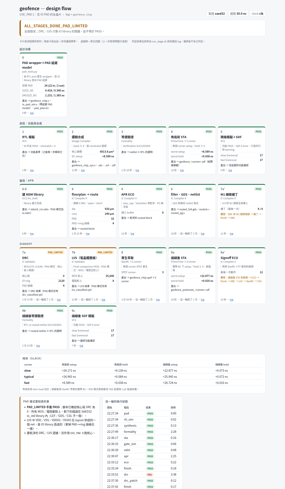

# IC_flow_skill

給 [Claude Code](https://claude.com/claude-code) 用的 **digital IC（cell-based）RTL → GDS 教學流程**，包含兩部分：

1. **`digital-ic-flow` skill**：每個階段在做什麼、怎樣才算通過、實際踩過的坑，加上每個階段一份可以直接填的 Synopsys 公版腳本（`.tcl`／`.sh`）。Claude 會在你問到 IC 流程、要寫或檢查 dc_shell／pt_shell／icc2_shell 腳本、或某一步失敗時自動使用。
2. **`/ic_flow` 面板**：在 Claude Code 右側開一個面板，即時顯示專案目前跑到哪一個階段、每一步的 PASS／FAIL 與關鍵數字。點任一階段可以看說明、通過標準、產出與 log 結果行，以及該階段的動畫。

腳本整理自 IC Contest 風格的 lab（geofence、REFRACT），在 SAED32 EDK 與 CBDK_IC_Contest 上實際跑過。

## 流程

| # | 階段 | 工具 |
|---|---|---|
| 0 | 要不要上 IO PAD（`USE_PAD`），產生 chip wrapper 與帶延遲的 PAD model | `pad_tools.py` |
| 1 | RTL 模擬 | VCS |
| 2 | 邏輯合成 | Design Compiler |
| 3 | 等價驗證 | Formality |
| 4 | 佈局前 STA（三個 corner） | PrimeTime |
| 5 | 閘級模擬＋SDF | VCS |
| 6 | APR：NDM → floorplan → place → CTS → route → ECO → finish | IC Compiler II |
| 7 | DRC／LVS（電晶體層級） | IC Validator |
| 8 | 寄生萃取 | StarRC |
| 9 | 繞線後 STA／Formality／SDF 模擬 | PrimeTime、Formality、VCS |

每個腳本最後都會解析報告並印出成功標記，**判定依據是報告內容，不是工具的 exit code**。`run_stage.sh` 會把每一步的結果寫進 `runs/<stage>/status.txt`，並更新 `runs/dashboard.html`（瀏覽器可看的流程儀表板）。

這個 skill 是教學用的：每次要跑流程前，Claude 都會先問你要跑「無 PAD（只有核心）」、「有 PAD（全晶片）」還是兩種都跑，方便比較 PAD 延遲、1 pF 負載、die 大小與 DRC／LVS 的差別。

## 安裝

### 方法一：當 plugin 安裝（skill＋面板一起裝）

在 Claude Code 的提示列輸入：

```
/plugin install ic-flow --marketplace charlesHYC/IC_flow_skill
```

出現 `Add marketplace?` 時按 `y`，再選安裝範圍（建議 user，按 Enter）。

從 shell 安裝：

```
claude plugin install ic-flow --marketplace charlesHYC/IC_flow_skill
```

桌面版（`/plugin` 無法使用時）：點提示框旁邊的 **+** → **Plugins** → **Add marketplace**，輸入 `charlesHYC/IC_flow_skill`，再 **Add plugin**。

### 方法二：只裝 skill

```bash
git clone https://github.com/charlesHYC/IC_flow_skill.git
cp -r IC_flow_skill/skills/digital-ic-flow ~/.claude/skills/
```

## 使用

1. 開新專案時，跟 Claude 說例如「用 digital-ic-flow 幫我建一個跟 geofence 一樣的流程」。Claude 會先問要不要上 PAD，再把 `templates/` 複製到專案的 `scripts/`。
2. 依設計修改 `scripts/flow_config.tcl`（`DESIGN`、`RTL_FILES`、`CLK_PORT`、`PERIOD`、`PROCESS`、PDK 路徑…），以及模擬腳本檔頭的 tb、pattern、PASS 字串。
3. 一次跑完：`bash scripts/run_all.sh`；或逐階段跑：`bash scripts/run_stage.sh synthesis`。
4. 看進度：
   - Claude Code 裡輸入 `/ic_flow`（自動跟隨最近有動的專案）或 `/ic_flow <專案路徑>`，Esc 關閉。
   - 終端機：`bash scripts/run_stage.sh status`。
   - 瀏覽器：`runs/dashboard.html`。

## Demo：geofence 跑完整個流程

`examples/` 裡有兩個實際跑完的 geofence 專案（SAED32、30 ns），分別是無 PAD 與有 PAD 版本。只保留儀表板需要的資料：每個階段的 `status.txt` 和 log 裡的結果標記行。不含 netlist、GDS 或製程資料，所以不用裝 EDA 工具也能看。

| 專案 | 模式 | 結果 |
|---|---|---|
| [`examples/geofence_core`](examples/geofence_core) | `USE_PAD 0`（只有核心） | `ALL_STAGES_PASS`：DRC CLEAN、LVS PASS |
| [`examples/geofence_pad`](examples/geofence_pad) | `USE_PAD 1`（加 IO PAD 的全晶片） | `ALL_STAGES_DONE_PAD_LIMITED` |

**瀏覽器儀表板**（`runs/dashboard.html`，下圖為有 PAD 版本）：



無 PAD 版本的截圖：[docs/dashboard_geofence_core.png](docs/dashboard_geofence_core.png)

**終端機表格**（`bash scripts/run_stage.sh status`，完整內容見 [examples/geofence_pad/flow_table.txt](examples/geofence_pad/flow_table.txt)）：

```
┌──────────────────────────────────────────────┬─────────────┬──────────────────────────────────────────┬──────────┐
│ Stage (steps)                                │ Status      │ Key numbers                              │ Time     │
├──────────────────────────────────────────────┼─────────────┼──────────────────────────────────────────┼──────────┤
│ PAD_planning (pad_wrapper, pad_delay_model)  │ PASS        │ pads 24, in 0.42/0.34, out 1.23/1.36 ns  │ 0:00     │
│ RTL_coding (vcs_simulation)                  │ PASS        │                                          │ 0:02     │
│ Synthesis (design_compiler_synthesis)        │ PASS        │ area 6013.8, setup +8.589 ns             │ 0:13     │
│ ...                                          │             │                                          │          │
│ DRC (icv_drc)                                │ PAD_LIMITED │ core 0, io_ring 2120, stitch 4           │ 3:37 x3  │
│ LVS (icv_lvs_transistor)                     │ PAD_LIMITED │ MOS 25,640, RES 8 matched                │ 0:23 x2  │
│ STA_postroute (primetime_spef)               │ PASS        │ setup +22.877 / hold +0.016 ns           │ 0:19 x2  │
│ Gate_post (vcs_postroute_sdf)                │ PASS        │ SDF $removal warn 17/17                  │ 0:07     │
└──────────────────────────────────────────────┴─────────────┴──────────────────────────────────────────┴──────────┘
```

**自己打開看**（clone 之後）：

```bash
firefox examples/geofence_pad/runs/dashboard.html          # 瀏覽器儀表板
python3 skills/digital-ic-flow/templates/00_common/flow_dashboard.py examples/geofence_core --text   # 終端機表格
```

裝了 plugin 的話，在 Claude Code 輸入 `/ic_flow <repo 路徑>/examples/geofence_pad` 就能在面板上看。點任一階段可以看說明、通過標準、產出、log 結果行和該階段的動畫。

## 需求與注意事項

- **工具**：Synopsys VCS、Design Compiler、Formality、PrimeTime、IC Compiler II、IC Validator、StarRC（需自行取得授權），以及 Python 3。腳本預設用 `source /.bash_EDA` 載入工具環境，請依你的機器修改 `run_stage.sh`。
- **製程資料不包含在這個 repo**。腳本裡的 `/mnt/nfs/opt/PROCESS/...` 只是路徑範例，請改成你機器上 SAED32 EDK／CBDK_IC_Contest 的位置。SAED32 是 Synopsys 的教學用製程，依其授權不得另行散布。
- **`USE_PAD 1` 只支援 SAED32**（CBDK_IC_Contest 沒有 IO PAD library）。SAED32 `io_std` 的 LEF／GDS／CDL 彼此不一致，因此有 PAD 的版本 DRC／LVS 最多只會到 `PAD_LIMITED`（核心區乾淨、MOS／電阻全對上，剩下的錯誤都在 IO library 裡），**不等於 PASS**。詳細說明見 `skills/digital-ic-flow/references/pitfalls.md`。
- 尚未實測：`PROCESS cbdk` 分支用本公版重跑、bidirectional PAD、`io_std` 以外的 IO library。

## 檔案

```
.claude-plugin/          plugin 與 marketplace 設定
hooks/                   /ic_flow 面板（register.tsx、anim.ts、測試）
types/                   面板的狀態型別
examples/                demo 專案（geofence 無 PAD／有 PAD），可直接看儀表板
docs/                    README 用的截圖
skills/digital-ic-flow/
  SKILL.md               skill 本體：流程總覽、使用規則
  references/            flow_stages.md（每階段原理）、pitfalls.md（踩過的坑）、glossary.md（縮寫對照）
  templates/00_common/   flow_config.tcl、run_stage.sh、run_all.sh、flow_dashboard.py
  templates/01_…07_*/    各階段公版腳本
```

## 授權

[MIT](LICENSE)
